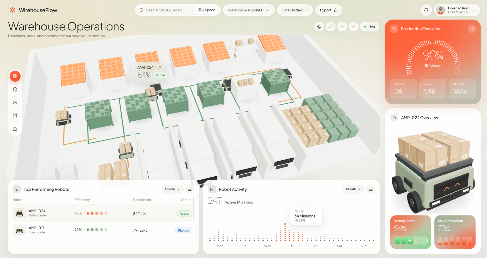

<div align="center">

# WirehouseFlow

**Real-Time 3D Autonomous Mobile Robot (AMR) Warehouse Operations & Fleet Telemetry Platform**


<br />
<br />



</div>

---

## Overview

**WirehouseFlow** combines an interactive **Three.js 3D warehouse floorplan** and **AMR studio inspector** with a full-stack **Express + Drizzle ORM + PostgreSQL** backend for telemetry ingestion, zone performance analytics, and operator access control.

- **Interactive 3D Spatial Twin**: Live animated AMRs navigating solar-orange high-bay storage, green pallet rack islands, carton staging zones, and 4 loading bays with raycast unit selection and dynamic 2D callouts.
- **UI-Driven PostgreSQL Schema**: Every dashboard metric (`ProductionOverviewCard`, `TopRobotsCard`, `RobotActivityCard`, `AmrOverviewCard`, and `Fleet Alerts`) maps directly to relational PostgreSQL tables managed via Drizzle migrations.
- **Authentication & Machine Ingest**: `scrypt` password hashing, HMAC-SHA256 Bearer sessions, first-run admin bootstrap, and scoped `X-API-Key` credentials for high-frequency robot telemetry ingestion.
- **Responsive Across Viewports**: Adapts seamlessly from mobile (`390px`) and tablet (`820px`) to full widescreen control-room desktops (`1440px+`).

---

## Project Structure

```text
wirehouseflow/
├── docs/
│   └── dashboard-preview.png                # Dashboard preview screenshot
├── drizzle/
│   ├── 0000_massive_marten_broadcloak.sql   # PostgreSQL schema migration
│   └── meta/                                # Drizzle snapshot metadata
├── public/                                  # Static public assets
├── src/
│   ├── components/
│   │   ├── AmrHeroCanvas.tsx                # 3D studio preview canvas for selected AMR
│   │   ├── AmrOverviewCard.tsx              # Unit health, battery cells & completion bars
│   │   ├── ProductionOverviewCard.tsx       # Radial efficiency tick gauge & zone KPIs
│   │   ├── RobotActivityCard.tsx            # 38-column interactive dot-matrix mission chart
│   │   ├── SideRail.tsx                     # Responsive vertical/horizontal workspace rail
│   │   ├── TopBar.tsx                       # Search, zone/date filters, alerts, auth & API keys
│   │   ├── TopRobotsCard.tsx                # Sortable/filterable fleet leaderboard
│   │   └── WarehouseCanvas.tsx              # Interactive 3D warehouse floorplan canvas
│   ├── data/
│   │   └── fleetData.ts                     # Default seed dataset & zone matrix
│   ├── db/
│   │   ├── index.ts                         # PostgreSQL pool & Drizzle client initialization
│   │   ├── schema.ts                        # Drizzle ORM table definitions & indexes
│   │   └── seed.ts                          # Idempotent initial warehouse data seeder
│   ├── server/
│   │   ├── auth.ts                          # scrypt, HMAC Bearer tokens, X-API-Key middleware
│   │   └── routes/
│   │       ├── authRoutes.ts                # /api/auth/* (bootstrap, login, register, keys)
│   │       ├── dashboardRoutes.ts           # /api/dashboard, /api/robots, /api/alerts, /api/export
│   │       └── ingestRoutes.ts              # /api/ingest/* (telemetry, metrics, snapshot)
│   ├── three/
│   │   ├── amrBuilder.ts                    # Composite procedural 3D AMR robot builder
│   │   ├── amrHeroScene.ts                  # PMREM studio lighting & OrbitControls preview
│   │   ├── sharedMaterials.ts               # Procedural CanvasTextures & WebGL capability checks
│   │   └── warehouseScene.ts                # Warehouse diorama, paths, raycasting & screen callouts
│   ├── types/
│   │   └── fleet.ts                         # Shared TypeScript domain interfaces
│   ├── App.tsx                              # Root layout, live API polling & in-memory auth state
│   ├── index.css                            # Tailwind CSS v4 theme & glass surface tokens
│   └── main.tsx                             # React 19 mount entry
├── .env.example                             # Environment variable template (no secrets)
├── drizzle.config.ts                        # Drizzle Kit PostgreSQL migration config
├── index.html                               # HTML shell & typography imports
├── package.json                             # Scripts & dependency manifest
├── server.ts                                # Full-stack Express + Vite middleware entrypoint
├── tsconfig.json                            # Strict TypeScript compiler configuration
└── vite.config.ts                           # Vite + Tailwind v4 build config
```

---

## Application Architecture

```text
┌────────────────────────────────────────────────────────────────────────────┐
│                        Browser Client (React 19 + Vite)                    │
│                                                                            │
│  ┌──────────────────────┐   ┌────────────────────┐   ┌──────────────────┐  │
│  │  TopBar & Auth Menu  │   │  Three.js Engines  │   │  Telemetry Cards │  │
│  │  • In-memory Bearer  │   │  • WarehouseScene  │   │  • Production    │  │
│  │  • Zone/Date Filters │   │  • AmrHeroScene    │   │  • Top Robots    │  │
│  │  • Fleet Alerts      │   │  • OrbitControls   │   │  • Activity Grid │  │
│  └──────────┬───────────┘   └─────────┬──────────┘   └────────┬─────────┘  │
└─────────────┼─────────────────────────┼───────────────────────┼────────────┘
              │ HTTP / JSON (Bearer & X-API-Key)                │
┌─────────────▼─────────────────────────▼───────────────────────▼────────────┐
│                     Express Application Server (server.ts)                 │
│                                                                            │
│  • Dev mode: Vite middlewareMode on port 3000                              │
│  • Prod mode: Static /dist SPA serving + /api/* gateway                    │
│  • Startup: Automatic Drizzle SQL migration + idempotent empty-DB seed     │
│                                                                            │
│  ┌────────────────────┐  ┌──────────────────────┐  ┌────────────────────┐  │
│  │ /api/auth/*        │  │ /api/dashboard       │  │ /api/ingest/*      │  │
│  │ • First-run claim  │  │ /api/robots/*        │  │ • /telemetry       │  │
│  │ • scrypt + HMAC    │  │ /api/alerts/*        │  │ • /zone-metrics    │  │
│  │ • API Key issuance │  │ /api/export          │  │ • /activity        │  │
│  └─────────┬──────────┘  └──────────┬───────────┘  │ • /alerts          │  │
│            │                        │              │ • /snapshot        │  │
│            └────────────────────────┼──────────────┴─────────┬──────────┘  │
│                                     ▼                        ▼             │
│                         Zod Input Validation + Drizzle ORM                 │
└─────────────────────────────────────┬──────────────────────────────────────┘
                                      │ SSL / Parameterized SQL
┌─────────────────────────────────────▼──────────────────────────────────────┐
│                           PostgreSQL Database                              │
│                                                                            │
│  zone_metrics • robots • robot_activity_columns • fleet_alerts             │
│  robot_telemetry_logs • users • auth_sessions • api_keys                   │
└────────────────────────────────────────────────────────────────────────────┘
```

### Data & Security Flow
1. **Live Telemetry Hydration**: `App.tsx` queries `GET /api/dashboard?zone=...&dateRange=...` on mount, on filter updates, and at 10-second intervals when **Live** mode is enabled.
2. **Authentication Model**:
   - First-run deployments expose `POST /api/auth/bootstrap` to claim the initial `admin` account (`users`), locking automatically once an admin exists or when `ADMIN_PASSCODE` is set.
   - Passwords are salted and hashed with Node `crypto.scryptSync` and compared with `crypto.timingSafeEqual`.
   - Session tokens are HMAC-SHA256 signed, tracked by SHA-256 hash in `auth_sessions` for instant revocation on logout, and held strictly in React memory.
3. **Ingest Pipeline**: External gateways or edge collectors authenticate via `X-API-Key: wf_live_...` or an operator Bearer token. Telemetry batches execute inside Drizzle transactions (`db.transaction`), updating `robots`, appending immutable records to `robot_telemetry_logs`, and auto-raising `fleet_alerts` when battery SoC drops to `<= 25%`.

---

## Tech Stack

| Layer | Technology | Purpose |
| :--- | :--- | :--- |
| **Frontend** | React 19, TypeScript, Vite 8 | Component architecture, state management, SPA bundling |
| **Styling** | Tailwind CSS v4, Plus Jakarta Sans, Codystar | Responsive layout, frosted glass surfaces, dot-matrix numerals |
| **3D Engine** | Three.js (`RoomEnvironment`, `OrbitControls`, `CanvasTexture`) | Real-time warehouse digital twin and studio AMR inspector |
| **Backend** | Express 4, Node.js 22 (`tsx` in dev, native `node` in prod) | Unified HTTP server, Vite dev middleware, REST API gateway |
| **ORM & DB** | Drizzle ORM, Drizzle Kit, `pg` (`node-postgres`), PostgreSQL | Type-safe schema, SQL migrations, connection pooling, transactions |
| **Validation & Auth** | Zod, Node `crypto` (`scrypt`, `HMAC-SHA256`, `SHA-256`) | Strict payload schemas, session verification, scoped API keys |

---

## How to Build & Run

### 1. Prerequisites
- **Node.js** `>= 22.18` (native TypeScript execution for `node server.ts`)
- **PostgreSQL** instance (local or hosted pooler such as Supabase / Cloud SQL)

### 2. Install Dependencies
```bash
npm install
```

### 3. Configure Environment Variables
Copy `.env.example` to `.env` (or configure secrets in your runtime environment) and populate your PostgreSQL connection parameters:

```env
PGHOST=your-postgres-host
PGPORT=5432
PGDATABASE=postgres
PGUSER=your-postgres-user
PGPASSWORD=your-postgres-password
PGSSLMODE=no-verify

# Optional: configure an environment-level admin passcode
# ADMIN_PASSCODE=
```

### 4. Generate & Apply Database Migrations
```bash
# Generate SQL migrations from src/db/schema.ts (when modifying schema)
npm run db:generate

# Apply SQL migrations to PostgreSQL
npm run db:migrate
```
> On server startup, `server.ts` also verifies pending Drizzle migrations and seeds initial warehouse data if the tables are empty.

### 5. Development Mode
Runs Express with Vite middleware on port `3000`:
```bash
npm run dev
```

### 6. Type Check, Build & Production Start
```bash
# TypeScript lint check
npm run lint

# Build frontend bundle into dist/
npm run build

# Start production Express server on port 3000
npm start
```

---

## API Quick Reference

### Core Endpoints
| Method | Endpoint | Auth | Description |
| :--- | :--- | :--- | :--- |
| `GET` | `/api/health` | Public | Server & PostgreSQL connectivity status |
| `GET` | `/api/dashboard` | Public | Live metrics, fleet robots, 38-column activity & alerts |
| `GET` | `/api/robots/:id` | Public | Robot state + latest 25 telemetry log entries |
| `POST` | `/api/auth/bootstrap` | First-run | Claim initial admin account (locks after 1st admin) |
| `POST` | `/api/auth/register` | Public | Register operator account & issue Bearer token |
| `POST` | `/api/auth/login` | Public | Sign in with email/password or `ADMIN_PASSCODE` |
| `POST` | `/api/auth/api-keys` | Bearer | Generate scoped `wf_live_...` telemetry ingest key |
| `PATCH` | `/api/robots/:id/status` | Bearer | Update robot status, cargo state, battery, or zone |
| `PATCH` | `/api/alerts/:id/acknowledge` | Bearer | Acknowledge an active fleet alert |
| `GET` | `/api/export` | Bearer | Export full PostgreSQL zone snapshot as JSON |
| `POST` | `/api/ingest/telemetry` | Bearer / `X-API-Key` | Ingest single or batch robot telemetry records |
| `POST` | `/api/ingest/zone-metrics` | Bearer / `X-API-Key` | Upsert zone KPI metrics |
| `POST` | `/api/ingest/activity` | Bearer / `X-API-Key` | Upsert daily mission dot-matrix columns |
| `POST` | `/api/ingest/snapshot` | Bearer / `X-API-Key` | Atomic bulk upsert across metrics, robots, activity & alerts |

### Example Telemetry Ingest Request
```bash
curl -X POST http://localhost:3000/api/ingest/telemetry \
  -H "Content-Type: application/json" \
  -H "X-API-Key: wf_live_your_generated_key" \
  -d '{
    "id": "AMR-024",
    "zoneName": "Warehouse A: Zone B",
    "role": "Pallet Carrier",
    "efficiency": 98,
    "completedTasks": 86,
    "status": "Active",
    "batteryHealth": 74,
    "taskCompletion": 81,
    "accentColor": "orange",
    "hasCargo": true
  }'
```
